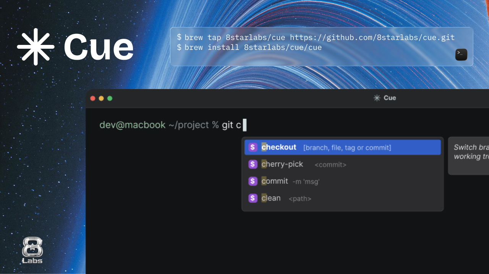

# Cue



IDE-style command and path suggestions for Apple Terminal and the VS Code integrated terminal.

Cue is for people who miss Fig's autocomplete. I loved Fig before [Amazon acquired its technology](https://techcrunch.com/2023/08/29/amazon-fig-command-line-terminal-generative-ai/), and built Cue after Kiro [announced the retirement of inline shell autocomplete](https://kiro.dev/blog/cli-3/).

**Available on:** Apple Silicon Macs running macOS 13 or later, in Apple Terminal or the VS Code integrated terminal with zsh!

## Install

1. **[Homebrew](https://brew.sh)**

   ```sh
   brew tap 8starlabs/cue https://github.com/8starlabs/cue.git
   brew install 8starlabs/cue/cue
   ```

   Add the source command printed by Homebrew to `~/.zshrc`, then open a new zsh session in Apple Terminal or VS Code. In VS Code, select zsh with **Terminal: Select Default Profile** if needed.

2. **Build from source**

   Requires Node.js 22+, pnpm 10+, and Xcode Command Line Tools.

   ```sh
   git clone https://github.com/8starlabs/cue.git
   cd cue
   pnpm install
   pnpm build:app
   source "$PWD/packages/cue/zsh/cue.zsh"
   ```

macOS may ask you to allow Cue under **System Settings → Privacy & Security → Accessibility**. See the [installation docs](apps/docs/content/docs/getting-started.mdx) for persistent shell setup, updates, and removal.

## Contributing

See [CONTRIBUTION.md](CONTRIBUTION.md) for development setup, checks, and release instructions.

## Credits

- [Fig Autocomplete](https://github.com/withfig/autocomplete) for command specs and Fig icons.
- [Material Icon Theme](https://github.com/material-extensions/vscode-material-icon-theme) for selected file icons.
- [`shell-quote`](https://github.com/ljharb/shell-quote) for shell command parsing.
- [Next.js](https://github.com/vercel/next.js), [Tailwind CSS](https://github.com/tailwindlabs/tailwindcss), [shadcn/ui](https://github.com/shadcn-ui/ui), and [Fumadocs](https://github.com/fuma-nama/fumadocs) for the documentation site.

## Contact

- Tham Kei Lok (Lead Engineer & Developer Relations) — [X](https://www.x.com/keiloktql/), [LinkedIn](https://www.linkedin.com/in/keiloktql/)

Engineered by [8StarLabs](https://8starlabs.com).

## License

[MIT](LICENSE)
